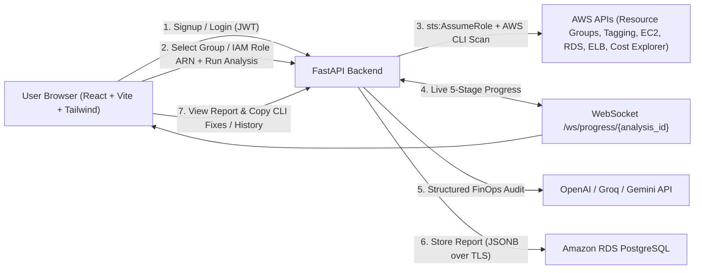

# AI Cloud Cost Detective (AWS FinOps Analyzer)

An AI-powered AWS FinOps web application that scans an AWS account (by Resource Group, CloudFormation Stack, Tag Filter, Service, or **Full Account Scan**), analyzes resources and 30-day AWS Cost Explorer spend with an LLM (OpenAI `gpt-4o`, Groq, or Google Gemini), streams live scan progress over WebSockets, and persists per-user audit history in **Amazon RDS for PostgreSQL**.

---

## Key Features

- **Custom JWT Authentication** — Email/password signup and login backed by `bcrypt` password hashing, `PyJWT` (`HS256`) tokens, protected React routes (`/dashboard`, `/report`, `/history`), and automatic `401` session handling.
- **IAM Role-Based AWS Scanning (`sts:AssumeRole`)** — Scans target AWS accounts safely using temporary STS credentials (`aws sts assume-role`) via Python's `subprocess` module (`shell=False`) with least-privilege read-only permissions.
- **Full Account & Grouped Discovery** — Supports:
  - `all` — **Full AWS Account Scan** across EC2 instances, EBS volumes (including orphaned/unattached volumes), NAT Gateways, RDS DB instances, ELBv2 Load Balancers, ElastiCache clusters, plus all tagged resources via AWS Resource Groups Tagging API and 30-day Cost Explorer spend.
  - Formal **AWS Resource Groups** (`aws resource-groups list-group-resources`).
  - **CloudFormation Stacks** (`stack:<stack-name>`), **Tag Filters** (`tag:Key=Value`), and **Service Filters** (`service:ec2`).
  - Optional **Demo Mode** (`DEMO_MODE=true`) for testing the full UI/AI/WebSocket/RDS flow without AWS credentials.
- **AI Cost Optimization Engine** — Identifies over-provisioning, unused/idle resources, misconfigurations, legacy instance families/pricing tiers, and storage tiering opportunities, returning:
  - Executive summary
  - Severity-ranked issues (`high` / `medium` / `low`) with ARN, issue type, explanation, cost impact, and recommendation
  - Estimated monthly & annual USD savings
  - Copyable, ready-to-run **AWS CLI v2 fix commands** targeting actual resource IDs and regions
- **Live WebSocket Progress** — Streams 5 real-time stages over `ws://localhost:8000/ws/progress/{analysis_id}` with automatic reconnect & event replay.
- **Amazon RDS PostgreSQL History** — Stores `users` and `analyses` (`JSONB` full reports) over SSL/TLS (`asyncpg`) so past reports can be browsed, searched, and reloaded anytime.

---

## Architecture & Request Flow



### End-to-End Flow (Steps 1–7)
1. **Authentication:** User signs up or logs in via `POST /api/auth/signup` or `POST /api/auth/login`. The JWT is stored in `localStorage` and attached as `Authorization: Bearer <token>` on all protected requests.
2. **Target Selection:** On `/dashboard`, the user enters an AWS IAM Role ARN (optional External ID) and clicks **Connect Role & Load Account** (`GET /api/resource-groups`), then selects `all` (Full Account Scan) or a specific Resource Group / tag / stack filter.
3. **AWS CLI Scanning:** `aws_scanner.py` assumes the IAM Role (`aws sts assume-role`), queries AWS Resource Groups / Tagging API / service-specific `describe-*` commands, and pulls 30-day spend via `aws ce get-cost-and-usage`.
4. **WebSocket Progress:** Simultaneously, the backend streams 5 stages over `ws://localhost:8000/ws/progress/{analysis_id}`:
   - `Fetching resource groups...`
   - `Scanning resources in <rg>...`
   - `Analyzing costs with AI...`
   - `Storing results...`
   - `Analysis complete`
5. **AI Cost Analysis:** `ai_analyzer.py` sends the prioritized resource inventory and 30-day Cost Explorer summary to the configured LLM and normalizes the JSON output.
6. **RDS Persistence:** `db.py` saves the full report into the `analyses` table (`JSONB`) scoped to the authenticated `user_id`.
7. **Report & History:** The frontend opens `/report/:analysisId` with KPI cards, severity badges, cost impact, copyable AWS CLI fix commands, and expandable resource inventory. Past runs are available anytime under `/history`.

---

## Tech Stack

| Layer | Technologies |
| :--- | :--- |
| **Frontend** | React 18, TypeScript, Vite 5, Tailwind CSS 3, React Router v6, Lucide Icons |
| **Backend** | Python 3.12, FastAPI, Uvicorn, Pydantic v2, WebSockets |
| **Cloud Integration** | AWS CLI v2 (`subprocess`), AWS STS (`AssumeRole`), Resource Groups, Tagging API, EC2, RDS, Lambda, DynamoDB, ELBv2, ElastiCache, S3, Cost Explorer |
| **AI Providers** | OpenAI (`gpt-4o`), Groq (`openai/gpt-oss-120b`), Google Gemini (`gemini-2.5-flash`) via OpenAI-compatible SDK |
| **Database** | Amazon RDS for PostgreSQL (`asyncpg` with SSL/TLS) |
| **Auth** | Custom JWT (`PyJWT` HS256) + `bcrypt` password hashing |

---

## Project Structure

```text
CostExplorer/
├── backend/
│   ├── main.py            # FastAPI app, JWT auth routes, REST endpoints, WebSocket manager
│   ├── aws_scanner.py     # AWS CLI subprocess runner, sts:AssumeRole, full-account & group scanner
│   ├── ai_analyzer.py     # Prompt builder, OpenAI / Groq / Gemini client, JSON normalization
│   ├── db.py              # Async Amazon RDS PostgreSQL pool (TLS), schema init, user/history queries
│   ├── requirements.txt   # Python dependencies
│   └── .env.example       # Environment variable template (never commit .env)
├── frontend/
│   ├── src/
│   │   ├── App.tsx
│   │   ├── main.tsx
│   │   ├── types.ts
│   │   ├── index.css
│   │   ├── lib/api.ts
│   │   ├── context/AuthContext.tsx
│   │   ├── components/
│   │   │   ├── Navbar.tsx
│   │   │   └── ProgressTracker.tsx
│   │   └── pages/
│   │       ├── Login.tsx
│   │       ├── Signup.tsx
│   │       ├── Dashboard.tsx
│   │       ├── Report.tsx
│   │       └── History.tsx
│   ├── package.json
│   ├── tailwind.config.js
│   ├── postcss.config.js
│   ├── vite.config.ts
│   └── index.html
├── .gitignore
└── README.md
```

---

## Prerequisites

- **Python 3.10+** (tested with 3.12)
- **Node.js 18+** & `npm`
- **AWS CLI v2** installed and available on `PATH`
- **Amazon RDS PostgreSQL** instance (with inbound TCP `5432` allowed from your IP)
- An API key from **OpenAI**, **Groq** (free tier), or **Google AI Studio / Gemini** (free tier)

---

## AWS IAM Setup (Least-Privilege Read-Only Role)

### 1. Create the Target Read-Only IAM Role (`CostDetectiveReadOnlyRole`)
Attach this inline **Permissions Policy**:

```json
{
  "Version": "2012-10-17",
  "Statement": [
    {
      "Sid": "CostDetectiveReadOnlyScan",
      "Effect": "Allow",
      "Action": [
        "resource-groups:ListGroups",
        "resource-groups:ListGroupResources",
        "tag:GetResources",
        "ec2:DescribeInstances",
        "ec2:DescribeVolumes",
        "ec2:DescribeNatGateways",
        "rds:DescribeDBInstances",
        "lambda:GetFunctionConfiguration",
        "dynamodb:DescribeTable",
        "elasticloadbalancing:DescribeLoadBalancers",
        "elasticache:DescribeCacheClusters",
        "s3:GetBucketLocation",
        "ce:GetCostAndUsage"
      ],
      "Resource": "*"
    }
  ]
}
```

Set the **Trust Policy** (replace `123456789012` with your AWS Account ID):

```json
{
  "Version": "2012-10-17",
  "Statement": [
    {
      "Sid": "AllowCostDetectiveAssumeRole",
      "Effect": "Allow",
      "Principal": {
        "AWS": "arn:aws:iam::123456789012:root"
      },
      "Action": "sts:AssumeRole"
    }
  ]
}
```

### 2. Caller Permissions (`sts:AssumeRole`)
- **On AWS (EC2 / ECS / App Runner):** Attach an IAM instance/task role with `sts:AssumeRole` on `CostDetectiveReadOnlyRole` (no static access keys needed).
- **For local development:** Create a minimal IAM user (`cost-detective-caller`) with only `sts:AssumeRole` on `arn:aws:iam::123456789012:role/CostDetectiveReadOnlyRole`, generate an access key, and add `AWS_ACCESS_KEY_ID` and `AWS_SECRET_ACCESS_KEY` to `backend/.env`.

---

## Local Setup & Running

### 1. Configure Backend Environment
```powershell
cd backend
Copy-Item .env.example .env
```

Edit `backend/.env` and configure:
- `DATABASE_URL` — Amazon RDS PostgreSQL connection string (`?sslmode=require`)
- `JWT_SECRET` — Strong random 64-char hex secret
- One AI provider key: `OPENAI_API_KEY`, `GROQ_API_KEY`, or `GEMINI_API_KEY`
- For local `sts:AssumeRole`: `AWS_ACCESS_KEY_ID`, `AWS_SECRET_ACCESS_KEY`, and `AWS_REGION`
- Optional: `DEMO_MODE=true` to test with simulated AWS resources when no Role ARN is entered

### 2. Run the FastAPI Backend
```powershell
cd backend
python -m venv .venv
.\.venv\Scripts\Activate.ps1
pip install -r requirements.txt
uvicorn main:app --reload --port 8000
```
API docs are available at `http://localhost:8000/docs` and health status at `http://localhost:8000/api/health`.

### 3. Run the React Frontend (second terminal)
```powershell
cd frontend
npm install
npm run dev
```
Open **`http://localhost:5173`** in your browser.

---

## API & WebSocket Reference

| Method / Protocol | Endpoint | Auth | Description |
| :--- | :--- | :--- | :--- |
| `GET` | `/api/health` | Public | Checks AWS CLI, AI key, JWT secret, and RDS PostgreSQL connectivity |
| `POST` | `/api/auth/signup` | Public | Creates a user (bcrypt hash) and returns a JWT |
| `POST` | `/api/auth/login` | Public | Validates credentials and returns a JWT |
| `GET` | `/api/auth/me` | Bearer JWT | Returns the authenticated user profile |
| `GET` | `/api/resource-groups` | Bearer JWT | Returns `all` (Full Account Scan), AWS Resource Groups, stacks, and tag groups |
| `POST` | `/api/analyze` | Bearer JWT | Scans AWS resources, runs AI analysis, streams WS progress, and saves to RDS |
| `GET` | `/api/history` | Bearer JWT | Lists past analyses for the authenticated user |
| `GET` | `/api/history/{analysis_id}` | Bearer JWT | Fetches a single saved analysis report from RDS |
| `WS` | `/ws/progress/{analysis_id}` | Optional `?token=` | Streams live 5-stage progress updates (with replay on reconnect) |

---

## Database Schema (Amazon RDS PostgreSQL)

Tables are created automatically on FastAPI startup (`backend/db.py`):

- **`users`**: `id`, `email` (unique), `password_hash`, `created_at`
- **`analyses`**: `id`, `user_id` (FK → `users.id`), `resource_group`, `resources_scanned`, `issues_found`, `estimated_savings`, `analysis_result` (`JSONB`), `status`, `created_at`

---

## Security Notes

- Never commit `.env` files, AWS access keys, RDS passwords, or API keys (`.gitignore` blocks all `.env` files while keeping `.env.example`).
- All AWS CLI commands are invoked via `subprocess.run([...], shell=False)` to prevent shell injection.
- All RDS PostgreSQL connections enforce SSL/TLS encryption by default.
