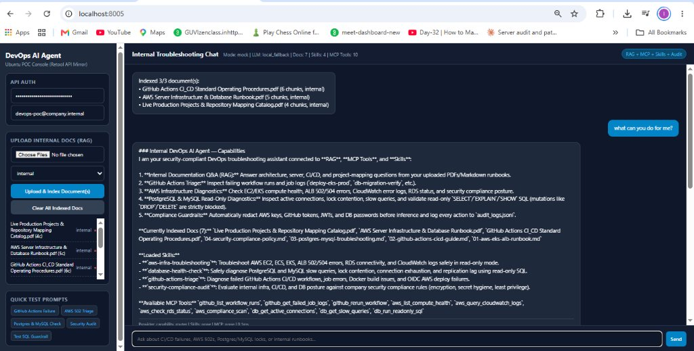
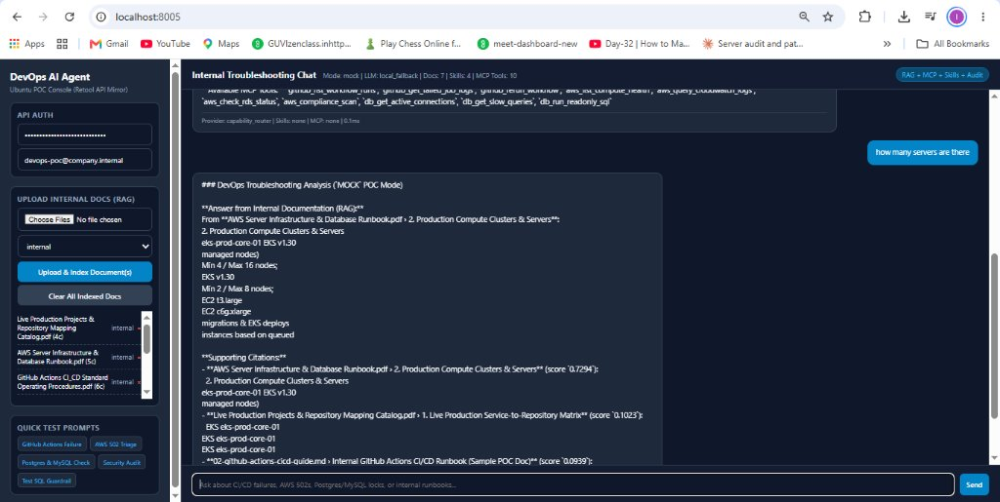

# DevOps Internal AI Agent (Retool + RAG + MCP + Skills)

A security-compliant, local-first **Internal DevOps AI Agent** designed for **Retool** integration using **RAG (Retrieval-Augmented Generation)**, **MCP (Model Context Protocol)** servers, and declarative **Agent Skills**. It helps engineering teams troubleshoot **GitHub Actions CI/CD pipelines**, **AWS infrastructure**, **PostgreSQL**, and **MySQL** using internal company runbooks while enforcing strict security guardrails.

---

## Key Capabilities & Security Compliance

- **Multi-Document & Multi-PDF RAG Ingestion**
  - Upload single or multiple internal runbooks (`.pdf`, `.md`, `.txt`, `.yaml`, `.json`, `.sql`) via the built-in POC console or Retool File Dropzone (`/api/v1/docs/upload-multiple`, `/api/v1/docs/upload-batch-base64`).
  - Automatic Unicode normalization, hyphenation repair, numbered-heading section chunking, and persistent SQLite vector storage (`data/rag_store.db`).
- **Automatic Secret & Credential Redaction**
  - Masks AWS IAM keys (`AKIA...`, `ASIA...`), GitHub tokens (`ghp_...`, `github_pat_...`), JWTs, private key blocks, database passwords in DSNs, and `key=value` secrets **before** indexing or LLM inference.
- **Strict Read-Only Infrastructure & Database Guardrails**
  - **SQL Validator**: Permits only single-statement read-only queries (`SELECT`, `SHOW`, `EXPLAIN`, `DESCRIBE`, `WITH`) and blocks mutations (`DROP`, `DELETE`, `UPDATE`, `INSERT`, `ALTER`, `TRUNCATE`, `PG_TERMINATE_BACKEND`, stacked `;`).
  - **CI/CD Mutation Gate**: Blocks workflow reruns (`github_rerun_workflow`) unless `ALLOW_CI_MUTATIONS=true` and explicit human approval is supplied.
- **Immutable Compliance Audit Trail**
  - Every chat prompt, matched skill, RAG citation, MCP tool call, secret redaction event, and document upload/deletion is recorded in `data/audit_logs.jsonl` with caller identity (`X-User-Email`, `X-User-Role`, `X-Client-Source`).
- **Private Local LLM Support**
  - Works out of the box in `local_fallback` POC mode, or connects to local **Ollama** (`llama3.1:8b` + `nomic-embed-text`) or a private VPC OpenAI-compatible gateway so confidential documentation never leaves your network.

---

## Architecture

```text
Retool UI (Chat + Multi-File Dropzone + Audit Table)
   │  Headers: X-API-Key, X-User-Email, X-User-Role, X-Client-Source
   ▼
FastAPI Agent Backend (app/main.py — Port 8005)
   ├── Security & Compliance Layer (app/security/)
   │     ├── redactor.py     (Credential & secret masking)
   │     ├── guardrails.py   (Read-only SQL & CI mutation policy gate)
   │     ├── auth.py         (API key / Bearer auth + Retool identity)
   │     └── audit.py        (Append-only JSONL audit logger)
   ├── Skills Registry (skills/*/SKILL.md)
   │     ├── github-actions-triage
   │     ├── aws-infra-troubleshooting
   │     ├── database-health-check
   │     └── security-compliance-audit
   ├── Local RAG Engine (app/rag/)
   │     ├── chunker.py      (PDF/Markdown parser & section chunker)
   │     ├── embeddings.py   (Ollama embeddings / zero-leak local hash)
   │     └── vector_store.py (SQLite hybrid cosine + lexical search)
   └── MCP Servers (app/mcp/servers/) [JSON-RPC 2.0 stdio + in-process]
         ├── github-actions-mcp
         ├── aws-infra-mcp
         └── db-diagnostics-mcp (PostgreSQL & MySQL)
```

---

## Project Structure

```text
Devops-internal-agent/
├── app/
│   ├── main.py                        # FastAPI endpoints & built-in POC web UI
│   ├── config.py                      # Environment configuration (Pydantic Settings)
│   ├── agent/
│   │   ├── llm.py                     # Ollama / OpenAI-compatible / local fallback client
│   │   └── orchestrator.py            # Skill matching + RAG + MCP orchestration
│   ├── mcp/
│   │   ├── client.py                  # MCP Client Manager (in-process & stdio subprocess)
│   │   ├── stdio_protocol.py          # JSON-RPC 2.0 MCP stdio server runtime
│   │   └── servers/
│   │       ├── github_actions_server.py
│   │       ├── aws_infra_server.py
│   │       └── db_diagnostics_server.py
│   ├── rag/
│   │   ├── chunker.py                 # PDF/Markdown extractor & secret-safe chunker
│   │   ├── embeddings.py              # Local embeddings + DevOps synonym expansion
│   │   └── vector_store.py            # Persistent SQLite vector store
│   ├── security/
│   │   ├── auth.py
│   │   ├── audit.py
│   │   ├── guardrails.py
│   │   └── redactor.py
│   ├── skills/loader.py               # SKILL.md parser & trigger matcher
│   └── static/index.html              # Local Ubuntu POC Chat & Multi-PDF Upload UI
├── skills/                            # Declarative DevOps SKILL.md playbooks
├── sample_docs/                       # Non-secret Markdown & dummy PDF fixtures
│   └── pdfs/                          # 4 sample PDFs (GitHub Actions, AWS, Live Map, DB)
├── retool/
│   ├── RETOOL_SETUP_GUIDE.md          # Retool REST resource & component wiring guide
│   ├── retool_devops_agent_app.json   # Retool app blueprint
│   └── docker-compose.retool.yml      # Optional Self-Hosted Retool template
├── scripts/
│   ├── setup_ubuntu.sh                # Ubuntu/WSL venv setup, sample ingest & tests
│   ├── run_poc.sh                     # Starts Uvicorn on port 8005
│   ├── ingest_sample_docs.py          # Preloads sample_docs/ into RAG store
│   └── init_db/                       # Read-only Postgres & MySQL Docker init SQL
├── tests/                             # Pytest suite (Security, RAG, Skills, MCP, API)
├── results/                           # POC verification screenshots
├── docker-compose.yml                 # Agent + Postgres + MySQL + optional Ollama
├── Dockerfile
├── requirements.txt
└── requirements-live.txt              # Optional boto3, psycopg[binary], mcp SDK
```

---

## Registered MCP Tools & Skills

| MCP Server | Tool Name | Purpose |
| :--- | :--- | :--- |
| `github-actions-mcp` | `github_list_workflow_runs` | List recent CI/CD workflow runs & conclusions |
| `github-actions-mcp` | `github_get_failed_job_logs` | Fetch redacted failure logs for a workflow run |
| `github-actions-mcp` | `github_rerun_workflow` | Policy- and approval-gated workflow rerun |
| `aws-infra-mcp` | `aws_list_compute_health` | Check EC2/EKS node CPU/memory & ALB target health |
| `aws-infra-mcp` | `aws_query_cloudwatch_logs` | Query CloudWatch logs with secret redaction |
| `aws-infra-mcp` | `aws_check_rds_status` | Inspect RDS Postgres/MySQL encryption & connections |
| `aws-infra-mcp` | `aws_compliance_scan` | Read-only security posture & SG/S3 audit |
| `db-diagnostics-mcp` | `db_get_active_connections` | Inspect active & blocked sessions (Postgres/MySQL) |
| `db-diagnostics-mcp` | `db_get_slow_queries` | Retrieve slow query fingerprints & index hints |
| `db-diagnostics-mcp` | `db_run_readonly_sql` | Execute validated read-only SQL (`SELECT`/`SHOW`/`EXPLAIN`) |

---

## Quick Start (Local Ubuntu / WSL POC)

1. **Bootstrap environment & run tests:**
   ```bash
   chmod +x scripts/setup_ubuntu.sh scripts/run_poc.sh
   ./scripts/setup_ubuntu.sh
   ```
2. **Start the Agent API & POC Console on port `8005`:**
   ```bash
   ./scripts/run_poc.sh
   ```
3. **Open the UI:**
   - Visit `http://localhost:8005`
   - Upload multiple internal PDFs (sample PDFs are included in `sample_docs/pdfs/`) and test troubleshooting prompts.

---

## Full Docker Stack (PostgreSQL + MySQL + Local Ollama)

```bash
# Start Agent API (port 8005) + local read-only Postgres & MySQL
docker compose up -d --build

# Optional: run local Ollama for private LLM + embedding inference
docker compose --profile ollama up -d
docker exec -it poc-ollama ollama pull llama3.1:8b
docker exec -it poc-ollama ollama pull nomic-embed-text
```

Update `.env` with `LLM_PROVIDER=ollama` to switch from `local_fallback` to full Ollama LLM reasoning.

---

## Retool Integration

See [retool/RETOOL_SETUP_GUIDE.md](retool/RETOOL_SETUP_GUIDE.md) and [retool/retool_devops_agent_app.json](retool/retool_devops_agent_app.json) to connect:
- **Retool Chat** → `POST /api/v1/chat`
- **Multi-File Dropzone** → `POST /api/v1/docs/upload-batch-base64`
- **Indexed Docs Table** → `GET /api/v1/docs` / `DELETE /api/v1/docs/{doc_id}`
- **Compliance Audit Table** → `GET /api/v1/audit?limit=50`

For confidential company documentation, deploy **Self-Hosted Retool** inside your private VPC using [retool/docker-compose.retool.yml](retool/docker-compose.retool.yml).

---

## POC Results

### 1. Multi-PDF Upload & Capability Routing


### 2. RAG Lookup Across Uploaded Infrastructure PDFs


---

## Automated Tests

```bash
pytest -v
```

Covers secret redaction, read-only SQL validation, CI mutation gates, audit logging, PDF chunking & hybrid RAG search, Skills matching, MCP JSON-RPC stdio subprocess calls, and FastAPI/Retool endpoints (`13/13` tests passing).
